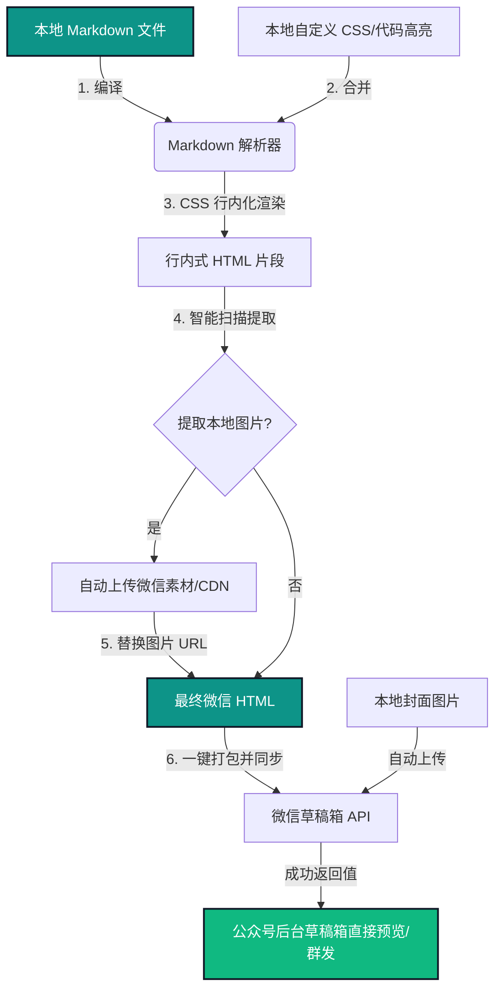

# 🚀 WeChat Markdown Sync Tool (微信公众号 Markdown 自动排版与草稿同步工具)

[](LICENSE)
[](https://www.python.org/)
[](#)

> **极客公众号作者的效率神器。** 彻底告别反人类的公众号后台编辑器，让你可以继续在最喜欢的 Markdown 编辑器（Typora, VSCode, Obsidian 等）中专注写作，剩下的排版与草稿同步工作，交由我们一键全自动搞定。

---

## 😫 传统运营者的痛点

你是否也曾在发布公众号文章时被这些恶心的问题折磨？

* **排版地狱**：直接粘 Markdown 格式到微信公众号后台会严重走样，被迫使用各种第三方网页排版器在浏览器标签页之间反复复制粘贴。
* **媒体同步繁琐**：Markdown 文档中的本地插图无法被微信编辑器识别，需要手动将图片一张张上传到微信媒体库，再挨个拖拽到正文中替换。
* **高亮代码格式化失效**：技术类公众号的代码块排版简直是灾难，微信官方甚至不提供好用的语法高亮，导致代码行被截断或背景丑陋。
* **令人窒息的 API 报错**：摘要稍长就触发 `45004` (Description size limit) 错误；在本地测试又经常因为外网 IP 未加白而抛出 `40164` (IP not in whitelist) 报错；Access Token 管理混乱导致额度早早耗光。

**WeChat Markdown Sync Tool 就是为此而生的自动化解放双手方案。**

---

## 🔄 核心同步流向图



---

## 📊 核心方案对比

| 功能特性 | 传统手动公众号排版 | 浏览器 Markdown 同步插件 | WeChat Sync Tool (本项目) |
| :--- | :---: | :---: | :---: |
| **写作环境** | 公众号后台网页 (极差) | 任意本地 Markdown 编辑器 | **任意本地 Markdown 编辑器** |
| **排版效率** | 手动逐段格式化 (极慢) | 手动复制 + 插件转换 (一般) | **CLI/网页一键完成 (秒级)** |
| **本地图片处理** | 需单独导出并手动逐张上传 | 仅支持公网图片或手动粘贴上传 | **自动扫描并替换为微信 CDN 地址** |
| **代码高亮定制** | 不支持，代码显示杂乱 | 受限于插件自带样式 | **Pygments 语法渲染，百款高亮注入** |
| **多媒体安全拦截** | 无自动保护，易超标报错 | 无法拦截处理 | **自动字节截断防微信 45004 报错** |
| **运行平台** | 浏览器 | 仅限特定安装了插件的浏览器 | **跨平台，支持 CLI & 现代 Web UI** |

---

## 🌟 核心特性

* 📱 **三模全场景交互体验**：
  * **原生 GUI 客户端**：基于 `pywebview` 打造的现代独立桌面客户端，双击直接运行，免去依赖任何浏览器标签页。
  * **Web UI 操作台**：内置现代深黛青 (Elegant Teal) 暗黑风格控制台。提供文件与封面图智能扫描选择、本地预览、无刷新配置面板及动态运行日志。
  * **CLI 命令行模式**：专为自动化极客和集成工作流（如 Git Hooks, CI/CD, 自动脚本）设计，一行命令瞬间同步。
* 📑 **外链自动转文末脚注 (Link-to-Footnotes)**：完美解决微信普通公众号正文无法直接点击外部超链接的痛点，自动将超链接转换为 `[1]` 上标角标，并在文末生成规范美观的「引用链接」参考资料列表。
* 🏷️ **Markdown YAML Frontmatter 原生自描述**：支持在文章头部编写 YAML Frontmatter 元数据（支持 `title`、`author`、`digest`、`cover`、`style`、`pygments_style` 等），与 Obsidian、Typora、VSCode 写作流浑然一体，免去手动输入参数的繁琐。
* 🎨 **多套排版设计风格主题**：
  * `default`：**优雅茶青 (Elegant Teal)** - 雅致耐看，通用阅读首选。
  * `tech`：**深邃科技蓝 (Tech Blue)** - 现代科技与技术沉浸感。
  * `minimal`：**极简冷灰 (Minimalist Gray)** - 黑白灰高级留白，高对比极简美。
  * `warm`：**暖意秋橙 (Warm Autumn)** - 温暖治愈系大地色调，适合人文随笔生活号。
* ⚡ **图片 MD5 缓存去重与并发秒传**：内置本地 `.image_cache.json` 哈希映射，同一张图片不重复上传微信 CDN；搭载多线程并发上传，多图长文同步速度成倍跃升。
* 💻 **服务端代码块高亮**：搭载 **Pygments** 高亮引擎，支持 `monokai`, `github`, `dracula` 等上百种经典配色，高亮样式同样直接转为 Inline Style。
* 🛡️ **健壮的防御性开发**：
  * **摘要字节截断**：未提供摘要时自动解析正文，针对微信严格的 **120字节** 限制进行安全的按字节截断，彻底阻断微信 `45004` 错误。
  * **IP 拦截辅助定位**：捕获经典的 `40164` (IP 未加白名单) 报错，提取您当前的公网请求 IP，并给出公众号后台配置的直接引导说明。
  * **智能 Token 缓存**：维护 `.wechat_token.json` 缓存，自动管理 Token 过期与刷新，避免触发微信 API 访问频率上限。

---

## 🛠️ 快速开始

### 1. 环境准备
项目推荐使用 Python 3.8 及以上版本。在项目根目录下安装所有运行依赖：
```bash
pip install -r requirements.txt
```

### 2. 配置微信公众平台凭证
你可以通过两种方式进行配置：
* **方式一 (推荐)**：在启动 Web UI 后直接在侧边栏配置面板中无刷新填写并保存。
* **方式二**：复制模板文件 `config.yaml.example` 为 `config.yaml`，用编辑器打开并填入你的 AppID 和 AppSecret：
  ```yaml
  wechat:
    appid: "你的微信公众号AppID"
    secret: "你的微信公众号AppSecret"
  ```
> 💡 **微信 IP 白名单说明**：若首次同步时控制台提示 `40164 (IP未加白)`，请登录「微信公众平台 -> 开发 -> 基本配置 -> IP白名单」，将控制台日志中打印出的您当前的公网 IP 加入微信的白名单配置中。

### 3. 运行程序

#### 💻 【方式 A】拉起高质感 Web UI / GUI 操作台（推荐）
直接在项目根目录下运行：
```bash
# 桌面独立应用窗口
python main.py --gui

# 或在默认浏览器中打开操作台
python main.py --ui
```

#### 🐚 【方式 B】终端命令行直接同步
如果你倾向于在 Shell 中操作，可以直接使用 CLI 模式：
```bash
python main.py --md articles/drafts/test.md --cover assets/cover.png --style tech
```

---

## ⚙️ 命令行进阶参数表

| 选项 (长/短) | 说明 | 默认值 |
| :--- | :--- | :--- |
| `--gui` | **启动原生桌面窗口客户端模式** (默认双击运行模式) | - |
| `--ui` | **启动图形化 Web UI 界面模式**（在浏览器打开操作台） | - |
| `-m, --md` | 本地 Markdown 文件路径 (若 Frontmatter 中有定义可不传封面) | - |
| `-c, --cover` | 封面图片路径 (本地图片，亦可在 Frontmatter 的 `cover` 中指定) | - |
| `-t, --title` | 图文标题（优先读取 Frontmatter，未指定则提取首个 `# H1`） | - |
| `-a, --author` | 作者（优先读取 Frontmatter，未指定则读取 `config.yaml`） | - |
| `-d, --digest` | 文章摘要（未指定则自动按 120 字节限额安全截断正文） | - |
| `--config` | 配置文件路径 | `config.yaml` |
| `--style` | 排版样式主题 (可选 `default`, `tech`, `minimal`, `warm` 或自定义 CSS) | `default` |
| `--pygments-style` | 代码块语法高亮主题 (可选 `monokai`, `github`, `dracula` 等) | `monokai` |
| `--no-footnotes` | **禁用外部链接自动转换为文末脚注功能** | 默认开启转脚注 |
| `--content-source-url` | 原文链接（即“阅读原文”超链接） | 无 |

---

## 🧪 本地排版效果预览

在正式发布至微信前，你可以运行测试脚本确认本地 HTML 转换效果（无需调用微信接口）：
```bash
python scripts/test_render.py
```
脚本将解析 `articles/drafts/test.md`，并在本地生成 `articles/output/output_test.html`。双击或使用浏览器打开即可查验样式行内化（Inline CSS）及代码高亮是否正确生成。

---

## 📁 目录规范架构

```text
auto-gzh/
├── autogzh/             # 核心系统库 (客户端、排版渲染器、Web 服务、GUI 容器)
├── ui/                  # Web UI 控制台前端资源 (static/ & templates/)
├── styles/              # 排版 CSS 样式表 (default.css)
├── articles/            # 创作专区 (与系统代码彻底隔离)
│   ├── drafts/          # Markdown 原稿
│   ├── output/          # 排版生成的本地 HTML (Git 忽略)
│   └── templates/       # 模板与文案样例
├── assets/              # 静态资源 (应用图标 app.ico、默认封面 cover.png 等)
├── scripts/             # 工具脚本 (打包 build_exe.py、本地测试 test_render.py 等)
├── main.py              # 统一启动入口
└── requirements.txt     # 依赖声明
```

---

## 🤝 参与贡献

我们欢迎并鼓励任何形式的贡献！无论是提交 Bug 反馈、功能申请，还是直接提交 Pull Request。

1. Fork 本项目到你的账户。
2. 新建你的特性分支 (`git checkout -b feature/AmazingFeature`)。
3. 提交你的修改并保持良好的 commit 信息 (`git commit -m 'Add some AmazingFeature'`) \。
4. 推送分支到 GitHub 仓库 (`git push origin feature/AmazingFeature`)。
5. 提交一个 Pull Request。

> ⚠️ 请在发起反馈和提交 PR 前查看我们的 [GitHub Issue & PR 规范模板](.github/)。

---

## 📝 许可证

本项目采用 [MIT License](LICENSE) 授权许可。
